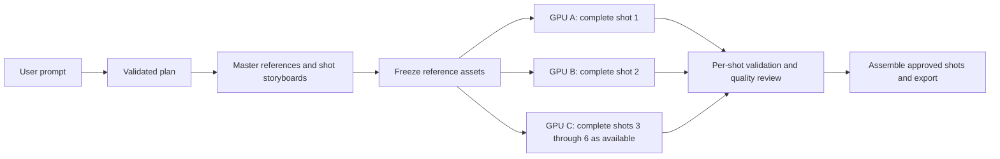

**Decompute: decentralized video feasibility and economics**

Research date: October 16, 2026. Target confirmed by the user: affordable 5–30 second, 720p clips on volunteer gaming GPUs. Prices are USD. This is a researched design and scenario model; no video inference, provider-fleet benchmark, paid API request, or deployment was performed.

> **Implementation status.** The design below is now built: project pipeline, provider protocol, server-measured node qualification, real-ffmpeg validation, and the customer and provider UI. A distilled 3-step preset was added after this study. At the published-runtime envelope, it is the only preset that clears the server's admission check at $0.60. Operating steps and the remaining launch gates are in [video-runbook.md](video-runbook.md).

**Decision**

Proceed with a measured pilot for short, edited, silent videos. A coordinator plans the video and freezes reference images; independent computers render complete shots; the coordinator checks and assembles them. A promising initial product is stylized social clips, product scenes, or B-roll with simple motion. Continuous 30-second action, perfect recurring faces, and synchronized dialogue need a separate quality and cost evaluation.

Profit while charging less is plausible, but remains unproven. At an assumed $0.30 per occupied GPU-hour and 80% acceptable attempts, a 30-second result costs about $0.47 at a nine-minute-per-shot envelope, or $0.25 if optimization achieves three minutes. Both include modeled ancillary costs and wallet payment fees at a $0.60 selling price. Those are contribution economics before fixed operations and labor. A $0.75 launch price is more defensible at the slower envelope; $0.60 should be gated by measurements.

The closest comparison is hosted inference of the same model: fal advertises Wan 2.2 5B image-to-video at $0.15 per clip, up to five seconds. Six clips are $0.90 before reference generation, editing, and unwanted takes. Beating this is more meaningful than comparing only against premium systems. [fal model and price](https://fal.ai/models/fal-ai/wan/v2.2-5b/image-to-video)

**1. AI selection and a reliable instruction process**

Use **Gemini 3.1 Flash-Lite** as the first planner candidate. It is a stable multimodal model with structured JSON output; that makes it suitable for producing a constrained shot list and inspecting reference images. Its creative planning quality on this workload still needs evaluation. [Official model capabilities](https://ai.google.dev/gemini-api/docs/models/gemini-3.1-flash-lite)

Its published standard text rates are $0.25/million input tokens and $1.50/million output tokens. A 3,000-input/2,000-billable-output-token request is $0.00375; thinking and repair requests can add tokens. Allocate $0.01/project initially. [Google pricing](https://ai.google.dev/gemini-api/docs/pricing)

If self-hosting the planner matters, evaluate Qwen2.5-7B-Instruct with vLLM JSON-schema constrained generation. Wan's own prompt-extension integration lists that model, and vLLM supports structured outputs. Keep this on a warm coordinator or dedicated provider; do not reserve a GPU for occasional tiny planning requests without including idle cost. [Wan prompt extension](https://github.com/Wan-Video/Wan2.2#2-using-prompt-extension), [vLLM structured outputs](https://docs.vllm.ai/en/latest/features/structured_outputs/)

The planning process should be:

1. Normalize the request into duration, aspect ratio, subject, action, setting, visual style, and constraints. Apply an explicit silent-video default for this product tier.
2. Produce a shared visual specification: subject identity, clothing/materials, proportions, location, palette, lighting direction, camera conventions, and prohibited changes.
3. Produce 1–6 shots. Limit each to one main action and one camera move. The planner chooses shot descriptions and reference IDs from known assets.
4. Validate JSON, then validate meaning in ordinary code: total timeline duration, valid asset references, compatible preset, allowed shot count, bounded prompts, and an acyclic dependency graph. Structured JSON alone does not establish cinematic correctness. [JSON-schema output mechanism](https://ai.google.dev/gemini-api/docs/structured-output)
5. Run a bounded repair pass with precise validation errors. Escalate complex plans to a stronger planner only when the extra cost improves acceptance. Reject unsupported constraints before spending video compute.
6. Generate a master subject/location reference and a first-frame storyboard for each shot. Check these together for identity and composition, then freeze them before fan-out. For an inexpensive starting implementation, evaluate SDXL with IP-Adapter reference conditioning. Reference conditioning is supported; exact identity preservation still needs testing. [Diffusers IP-Adapter guide](https://huggingface.co/docs/diffusers/using-diffusers/ip_adapter)
7. A deterministic compiler converts the approved plan into signed worker tasks. The server selects executable images, model revisions, scheduler settings, and resource budgets. An LLM must not select shell commands, arbitrary containers, or credentials.

Use **Wan2.2-TI2V-5B** as the reproducible video baseline. Its published single-GPU path uses 24 GB VRAM with offloading and offers text/image-to-video; the model card identifies Apache 2.0 licensing. [Official model card](https://huggingface.co/Wan-AI/Wan2.2-TI2V-5B)

The reference preset uses 24 fps, 121 frames, and 50 steps. Treat that as the quality baseline before experimenting with acceleration. [Upstream preset](https://github.com/Wan-Video/Wan2.2/blob/main/wan/configs/wan_ti2v_5B.py)

Evaluate alternatives without assuming the smallest model wins:

| Candidate | Why evaluate it | Qualification needed |
|---|---|---|
| Wan 2.2 5B | Clear baseline and modest model size | Native generation is 1280×704; explicitly pad to 1280×720 for delivery |
| Distilled Wan A14B with LightX2V | Fewer denoising steps may outweigh the larger model | Verify exact checkpoint, GPU, RAM, license, quality, and offloading cost; A14B LoRAs do not apply to the 5B model |
| LTX-2.5 distilled | Current open-weight alternative with audio and native multishot capabilities | Benchmark quantized/offloaded consumer-GPU configurations; its community license has commercial conditions |
| HunyuanVideo 1.5 | Published 14 GB offloaded minimum | The advertised fast distilled case is 480p; it is not evidence for native 720p economics, and the license excludes EU, UK, and South Korea |

Sources: [Wan resolution](https://github.com/Wan-Video/Wan2.2#run-text-image-to-video-generation), [LightX2V](https://github.com/ModelTC/LightX2V), [LTX-2.5 model card](https://huggingface.co/Lightricks/LTX-2.5), [Hunyuan hardware and speed](https://github.com/Tencent-Hunyuan/HunyuanVideo-1.5), [Hunyuan license](https://huggingface.co/tencent/HunyuanVideo-1.5/blob/main/LICENSE).

**2. Break the work into independently useful tasks**

The default unit is **one complete five-second shot on one GPU**, including text encoding, denoising, decoding, and local encoding. For 30 seconds, compile six shots; shorter edits can trim the final shot. Generate the supported frame count and trim to 120 delivery frames per five seconds. Account for all generated frames, including discarded frames, in measured runtime.



Independent cuts can render concurrently once their storyboards are approved. A continuation shot depends on the preceding approved ending frame and must wait. The initial Wan path conditions on one image; do not assume native first-and-last-frame constraints or shared hidden state. Repeated last-frame conditioning can drift, so use deliberate cuts and re-anchor to approved references.

An illustrative compiled task, with asset IDs resolved to verified storage objects by the coordinator:

```json
{
  "schema": "decompute.video-shot.v1",
  "projectId": "example-project",
  "shotId": "shot-02",
  "planRevision": 1,
  "presetId": "wan-ti2v5b-720-v1",
  "dependsOn": ["storyboard-02-approved"],
  "sharedStyleId": "visual-spec-v1",
  "referenceAssetId": "storyboard-02",
  "prompt": "The same small orange robot with a blue backpack walks left to right through the established sunlit garden. Medium shot, slow camera pan, warm afternoon light.",
  "seed": 184223,
  "render": { "width": 1280, "height": 704, "frames": 121, "fps": 24 },
  "edit": { "timelineStartFrame": 120, "keepFrames": 120 },
  "expectedState": { "subject": "orange-robot-v1", "backpack": "blue", "travelDirection": "left-to-right" }
}
```

The server adds the immutable container digest, exact model/adapter hashes, input checksums, sampler, precision, expiry, attempt ID, and cost ceiling. Hash the complete compiled specification, not just the prompt.

Do not divide arbitrary frames, image tiles, attention layers, or denoising steps among unrelated home PCs for the first product. Temporal modeling and cross-device communication make those boundaries expensive and difficult to reconstruct. xDiT is a real option for model parallelism on suitably connected machines, but support for distributed inference does not establish economical performance over residential internet. This recommendation is an engineering inference, not a WAN benchmark. [xDiT implementation](https://github.com/xdit-project/xDiT)

For scale intuition, an assumed 100 MB intermediate transfer takes at least eight seconds at 100 Mbps, excluding latency and contention; repeating it 50 times consumes 400 seconds. A 5 MB encoded shot takes about two seconds at 20 Mbps. Neither quantity is a measurement of Wan's interconnect traffic. Three remote 8 GB cards do not become one practical 24 GB video worker through this shot-based design.

**3. Execution, cohesion, and untrusted providers**

Keep a centralized control plane with distributed rendering. Providers maintain outbound authenticated connections, so residential users need no inbound ports. A durable queue schedules ready tasks using model availability, measured runtime, free VRAM, CPU RAM, network, reliability, and price.

The initial video pool should admit qualified NVIDIA 24 GB workers. Start testing with 64 GB system RAM and sufficient SSD space for the full pinned model bundle, then establish actual host-memory requirements. A GPU's advertised VRAM is not enough: test a complete render, including VAE decoding, while accounting for other applications. Linux and Windows/WSL2 need separate qualification. Smaller cards can contribute storyboard, validation, or encoding tasks where qualified; avoid promising full video participation to every gaming PC.

Each worker verifies the signed assignment, downloads scoped inputs, runs the allowlisted container, emits heartbeats/progress, and uploads an MP4 plus execution metadata. Model weights are prefetched outside the interactive job, verified, and cached. Reusing a warm process avoids repeated model loads, but must preserve the sandbox and clear job-specific state.

Use time-bounded leases with fencing tokens. A retry receives a new attempt identity; only the current attempt can commit an artifact or payment. A network retry preserves the creative seed and inputs. A quality retry intentionally changes the seed or repairs the prompt and records the new revision. Retrying one failed shot should not discard completed siblings.

Cohesion comes from actual conditioning and checks:

- Same master reference, approved per-shot first frames, exact model family/preset, aspect ratio, and visual specification throughout a project.
- Track subject attributes, screen direction, props, and scene state across cuts. A shared seed alone does not enforce identity, and different GPU kernels may not be bit-identical.
- Validate container/codec/duration/frame count and decode the full clip in a bounded sandbox. Detect blank/frozen footage, unexpected cuts, severe flicker, and corrupted frames.
- Compare sampled beginning/middle/end frames with references using image similarity and a multimodal reviewer. Calibrate checks against human ratings; embeddings can miss identity drift and legitimate action can resemble a continuity violation.
- Re-render only failing shots; use hard cuts in the initial product. Matching color and exposure helps presentation but cannot repair a different face or object.

A hash proves byte integrity, not that a provider performed the claimed inference. Use trusted reference renders, randomized audits/canaries, duplicate-result detection, reputation, and staged payouts. Full duplicate rendering would erase much of the saving. Handle technically valid but creatively rejected attempts distinctly from fraudulent results; the cost model pays for legitimate discarded attempts.

Home providers can inspect plaintext prompts and reference assets while computing. Keep API/payment secrets on the coordinator, issue narrow storage credentials, and make that privacy boundary clear. End-to-end encryption does not hide inputs from an ordinary GPU host executing inference.

**4. Performance and cost optimization**

Optimize **cost per accepted delivered second**, not raw GPU-hours or a selected successful sample:

`expected render cost per accepted shot = hourly provider rate × occupied seconds per attempt / (3600 × acceptance probability)`

Measure load, conditioning, denoising, VAE decode, encode, upload, and failed work. Qualify workers on this exact workload. A slower $0.20/hour GPU can cost more per accepted shot than a fast $0.40/hour GPU.

Priority order:

1. Approve composition and references before video generation. This targets costly creative retries.
2. Prewarm/cache the exact model revision and schedule locally to cached weights. Downloading an illustrative 20 GB bundle over 100 Mbps takes about 27 minutes at line rate; every-job downloads are uneconomic.
3. Compare the baseline with checkpoint-specific distilled models, quantization, attention kernels, and intermediate caching. LightX2V provides these techniques, but compatibility and speed depend on the model and GPU. Benchmark each optimization at equal human-rated acceptability. [LightX2V optimization support](https://github.com/ModelTC/LightX2V)
4. Keep one model/preset per project and run independent shots in parallel. Six GPUs can shorten the first render wave; they still consume roughly six shots' worth of GPU time. A continuous dependency chain remains sequential.
5. Prefer measured expected job cost within a fair-share pool; apply provider fairness among similarly economical eligible workers. Cap quoted project spend and avoid speculative duplicate work except for selected deadline recovery or audits.
6. Use CPU encoding/assembly when it frees valuable GPU time. Send compact references and encoded shots, not raw frames. Treat low-resolution generation followed by upscaling as a separately disclosed quality tier.
7. Use prepaid credit and aggregate provider payouts. At US domestic-card list pricing, charging a card separately for every $0.60 clip incurs $0.3174 in payment fees alone. [Stripe pricing](https://stripe.com/pricing)

Storage is usually secondary: R2 Standard advertises $0.015/GB-month and free direct egress, with request charges. An assumed 50 MB retained for one month is $0.00075 in storage before requests and other services. Expire intermediates; model distribution and repeated retries can be much larger than final-video storage. [R2 pricing](https://developers.cloudflare.com/r2/pricing/)

For owned/reserved GPUs, add idle cost: at 50% utilization, a $0.30/hour reservation costs $0.60 per busy hour. The scenarios below assume providers are paid only for occupied work and bear their own idle time. The proposed $0.30 is a business assumption, not a verified market offer or a promise that volunteers will accept it.

As an illustrative provider calculation, a 500 W whole-system draw at $0.20/kWh costs $0.10/hour. A $0.30 payout leaves $0.20/hour before hardware wear, cooling, bandwidth, taxes, and idle energy. At 120 paid hours/month this is $36 revenue and $12 active electricity cost. Free volunteer compute can subsidize a pilot but is not a durable profit assumption.

**5. Cost, competitors, and profit**

Published generation prices checked on the research date:

| Service | 5-second equivalent | 30-second equivalent | Comparison note |
|---|---:|---:|---|
| fal Wan 2.2 5B | $0.15 | $0.90 | Closest model comparison; six five-second clips |
| Runway Gen-4 Turbo | $0.25 | $1.50 | 5 credits/second at $0.01/credit |
| Veo 3.1 Lite, 720p | $0.25 | $1.50 | Includes generated audio |
| Veo 3.1 Fast, 720p | $0.50 | $3.00 | Includes generated audio |
| Runway Gen-4.5 | $0.60 | $3.60 | 12 credits/second |
| Veo 3.1 Standard | $2.00 | $12.00 | Includes generated audio |

Sources: [fal](https://fal.ai/models/fal-ai/wan/v2.2-5b/image-to-video), [Runway](https://docs.dev.runwayml.com/guides/pricing/), [Google](https://ai.google.dev/gemini-api/docs/pricing).

These are normalized list-price generation amounts, not necessarily purchasable five- or thirty-second native requests. Provider-supported durations and minimums can increase an actual order. They exclude sales tax, subscriptions/discounts, creative retries, reference images, and editing. The models differ in fidelity, motion, audio, and prompt adherence. Do not advertise equal quality without a blinded comparison. For fair operational comparisons, apply observed acceptance rates to the hosted alternatives too.

Wan reports generating a five-second 720p-class clip in under nine minutes on a consumer GPU without specific optimization. Use 540 seconds as a planning envelope, not a fleet measurement. The three-minute scenario is an unverified target. [Published baseline](https://github.com/Wan-Video/Wan2.2#2-efficient-high-definition-hybrid-ti2v)

For a 30-second edit of six shots, the shared assumptions are:

| Component | Budget |
|---|---:|
| Planner and bounded repairs | $0.0100 |
| Shared references and per-shot storyboards | $0.0400 |
| Automated QA and amortized audits | $0.0200 |
| Storage and transfer | $0.0050 |
| Assembly/encoding | $0.0050 |
| Support/refund/provider-payout reserve | $0.0200 |
| Ancillary subtotal | $0.1000 |
| Allocated payment cost on $0.60 revenue | $0.0354 |

All ancillary entries are budgets to validate, not vendor quotes. The reserve may be insufficient during an early pilot. Payment allocation assumes $10 credit purchases, fully spent, and 2.9% + $0.30 per purchase: `0.60 × (0.029 + 0.30/10)`. Provider payout fees and abuse losses beyond the reserve must be added from actual experience. No generated audio is included.

The calculation is:

```
N = ceil(delivered seconds / 5)
expected attempts = N / p
GPU cost = N × seconds per attempt × provider hourly rate / (3600 × p)
other cost = $0.02/project + N × ($0.08/6)
payment cost = selling price × (0.029 + 0.30/10)
contribution = selling price - GPU cost - other cost - payment cost
operating result = total contribution - fixed operations - labor - acquisition - other overhead
```

Here `p` combines technical completion and creative acceptance. It is not just uptime. The steady-state `1/p` estimate assumes retry cost averages are representative; correlations, capped attempts, and abandoned projects require measured cohort accounting. With independent 80% acceptance and at most three attempts per shot, all six shots succeed only about 95.29% of the time. A production budget must handle the remainder through refunds, repair, or a qualified fallback. Correlated hard prompts can be worse.

| 30-second scenario | Seconds/attempt | Provider $/hour | Acceptance | Total variable cost at $0.60 price | Contribution | Contribution margin |
|---|---:|---:|---:|---:|---:|---:|
| Optimized target, unverified | 180 | $0.30 | 80% | $0.2479 | $0.3521 | 58.7% |
| Published-baseline envelope | 540 | $0.30 | 80% | $0.4729 | $0.1271 | 21.2% |
| Adverse planning case | 600 | $0.60 | 65% | $1.0585 | -$0.4585 | -76.4% |

At the same assumptions, candidate duration tiers are:

| Output | Candidate selling price | Optimized target cost | Baseline-envelope cost | Hosted Wan generation only |
|---|---:|---:|---:|---:|
| 5 seconds | $0.12 | $0.0592 | $0.0967 | $0.15 |
| 15 seconds | $0.33 | $0.1357 | $0.2482 | $0.45 |
| 30 seconds | $0.60 | $0.2479 | $0.4729 | $0.90 |

These are candidate prices, not a recommendation to promise them before testing. At $0.60, a customer saves 33.3% against six hosted Wan clips and 60% against the normalized Gen-4 Turbo total, subject to quality differences. A $0.75 starting price yields $0.26825 contribution (35.8%) under the baseline envelope and still saves 16.7% against hosted Wan's raw generation amount.

For **35% contribution margin at $0.60**, with $0.30/hour, 80% acceptance, and the modeled overhead, average occupied time must be **407 seconds or less per five-second attempt**. At 540 seconds, the corresponding price floor is approximately **$0.7403**. These thresholds are more useful than an unsupported claim of tenfold savings.

Runpod currently displays an RTX 4090 pod rate of $0.89/hour; region and availability can differ. At that rate and 540 seconds/attempt, GPU cost alone is about $1.00 for six accepted shots at 80% acceptance. Renting expensive fallback capacity indiscriminately destroys the $0.60 offer. [Runpod current pricing](https://www.runpod.io/pricing)

Decentralization itself does not make the model more efficient. Centralized operators can run the same open weights with batching, faster hardware, and higher utilization. The potential advantage is inexpensive existing hardware, good worker qualification, low overhead, and an automated editing workflow; it must survive comparison with optimized hosted open models.

For a hypothetical $300/month fixed operating budget, the $0.60 tier needs about 853 completed projects/month in the optimized case or 2,361 at the slower envelope to cover those operations. At 10,000 projects/month, revenue is $6,000; modeled operating surplus is $3,221 optimized or $971 at the envelope, **before salaries, acquisition, tax, and development recovery**. Gross contribution is not net profit.

An initial budget estimate, separate from per-video costs:

- Benchmark program: allow roughly 200 GPU-hours, or $178 at the cited $0.89/hour rate; budget $200–300 including storage and reference/API experiments, plus human review time. Track cold downloads and idle rental time against that allowance.
- Existing-repo pilot engineering: approximately 160–320 hours, an estimation judgment rather than a quote. At an assumed $75–150/hour this is $12,000–48,000, excluding further production hardening and legal/accounting work. Founder implementation substitutes time for cash.
- Initial fixed control-plane/database/monitoring budget: $100–500/month as a planning allowance; replace with a deployment-specific quote. Provider GPU payouts remain variable. Acquisition, support staffing, and reserve capital depend on actual launch volume.

**What the current repository can reuse and what must change**

This assessment is based on source inspection, not a live-service audit.

| Existing component | Finding | Video work needed |
|---|---|---|
| [workloadCatalog.js](../server/src/lib/workloadCatalog.js) | Video placeholder has 40 GB minimum, no default image/model/result schema, and no unit keys | Add a real qualified preset, input schema, MP4 result contract, and measured resource limits |
| [jobBatch.js](../server/src/lib/jobBatch.js) | Groups independent units by concatenating env values; groups without capacity may be omitted | Durable shot records and a dependency queue; never silently omit a required shot; assemble only a complete timeline |
| [jobMatching.js](../server/src/lib/jobMatching.js) / [fairScheduling.js](../server/src/lib/fairScheduling.js) | Synchronous matching; fairness within an hourly-price band | Background scheduling based on expected accepted-shot cost, readiness, and deadline, while retaining bounded community fairness |
| [jobManifest.js](../server/src/lib/jobManifest.js) | Signed manifests, seed and input hashes already exist | Add exact preset/weight revisions, shared asset references, creative versus infrastructure attempt identities, and fencing |
| [docker.go](../helper/internal/docker/docker.go) / [policy.go](../helper/internal/workload/policy.go) | Curated sandbox and cache; default 12 GB host-memory cap; video image not enabled | Qualify video memory/offload needs, prefetch verified weights, enable a pinned workload, evaluate warm-process reuse |
| [agent.js](../server/src/routes/agent.js) / [resultValidation.js](../server/src/lib/resultValidation.js) | Artifacts are capped at 15 MB and stored in Postgres; no video validator | Object storage and resumable uploads, project-scoped assets, MP4 decode/quality validation, duration-aware quotas |
| [client/agent.go](../helper/internal/client/agent.go) | Shared HTTP client has a 15-second timeout | Make large-media transfers resumable and appropriately bounded for residential upload speeds |
| [jobSettlement.js](../server/src/lib/jobSettlement.js) | Adds 10% to GPU time, rounds children to cents, refunds failed jobs, deletes job-bound inputs | Separate retail project price from provider compensation; account for legitimate rejected renders; aggregate precise sub-cent costs; retain shared references through project completion |

The current 10% GPU markup is insufficient for the modeled turnkey service. For example, a $0.3375 provider compute subtotal earns only about $0.03375 before rounding; that does not cover $0.10 ancillary work plus payments. The existing settlement semantics do not implement the cost model above. Preserve accounting invariants while introducing a distinct video product and provider ledger flow.

**Pilot acceptance gates**

Use a held-out set of 100 diverse prompts, including multi-shot continuity, human motion, products, landscapes, and deliberate hard cases. Compare 3090/4090 and another admitted GPU class, with multiple seeds, using the exact container and quality preset. Include both native Wan and a qualified accelerated challenger. Use the same brief/reference and blinded reviewers for hosted Wan and at least one premium baseline.

Log all attempts: seconds by stage, memory peaks, energy where measurable, transferred bytes, node dropouts, human acceptance, automatic-check false accepts/rejects, continuity failures, refunds, and cost per accepted final second. Measure queue-to-delivery p50/p95 separately from GPU time. Run forced disconnect, late-result, duplicate-completion, insufficient-capacity, and upload-retry checks before real-money launch.

Proposed decision gates, not achieved results: at least 99% schema-valid plans after bounded repair; at least 80% shot acceptance on the intended product distribution; complete or explicitly refund every project; final-project reliability and p95 latency acceptable to users; and at least 35% contribution margin while saving 20% or more against a quality-comparable hosted workflow. Evaluate uncertainty and hard-prompt cohorts, not only averages. Start with 5-second clips, add independently cut 15/30-second edits, and only then attempt seamless continuation or dialogue.

Run the editable calculator with `node docs/video-cost-model.mjs`. Change [video-cost-assumptions.json](video-cost-assumptions.json), or pass another JSON file. Its estimates intentionally exclude inference and API calls. Refresh published prices and replace every assumed runtime, acceptance rate, and ancillary allowance with measurements before committing to retail prices.
